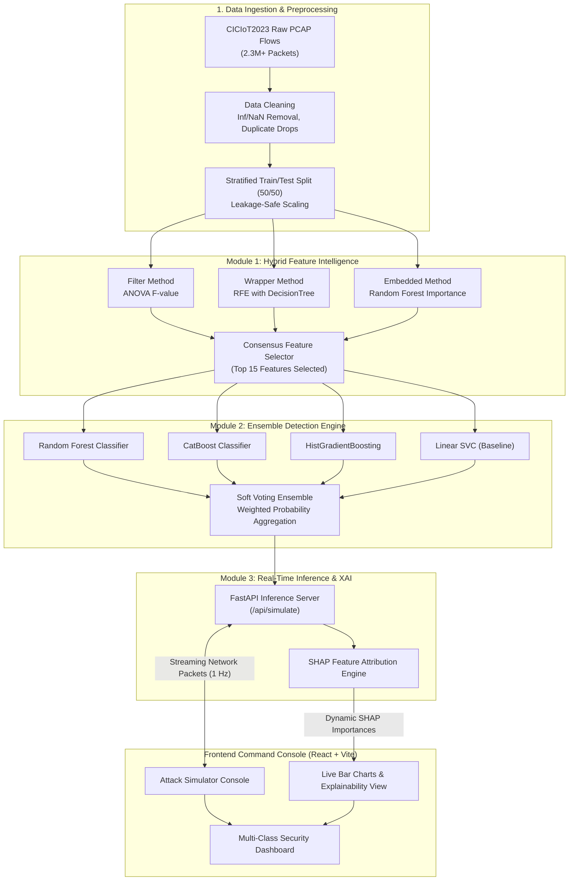

# 🛡️ SentinelAI — Multi-Class IoT Intrusion Detection System (IDS)

[](https://opensource.org/licenses/MIT)
[](https://www.python.org/)
[](https://fastapi.tiangolo.com/)
[](https://react.dev/)
[](https://www.typescriptlang.org/)
[](https://tailwindcss.com/)
[](https://www.unb.ca/cic/datasets/iot-dataset-2023.html)

**SentinelAI** is an end-to-end, full-stack Machine Learning platform and real-time defense console designed to detect, classify, and mitigate high-volume cyberattacks in modern Internet of Things (IoT) network infrastructure.

Trained on over **2.3 million real network packet flows** from the benchmark **CICIoT2023 dataset**, SentinelAI combines a novel **Hybrid Feature Intelligence Pipeline**, a **Soft Voting Ensemble Engine**, and **Explainable AI (SHAP)** with a sleek, interactive cyber defense command console.

---

## 📑 Table of Contents

- [Key Highlights](#-key-highlights)
- [System Architecture](#-system-architecture)
- [Machine Learning Modules](#-machine-learning-modules)
  - [Module 1: Hybrid Feature Intelligence](#module-1-hybrid-network-feature-intelligence)
  - [Module 2: Ensemble Detection Engine](#module-2-ensemble-detection-engine)
  - [Module 3: Security Analytics & Explainable AI](#module-3-security-analytics--explainable-ai)
- [Frontend Command Console](#-frontend-command-console)
- [Dataset Details (CICIoT2023)](#-dataset-details-ciciot2023)
- [Project Directory Structure](#-project-directory-structure)
- [Quick Start Guide](#-quick-start-guide)
  - [1. Backend Setup](#1-backend-setup)
  - [2. Frontend Setup](#2-frontend-setup)
  - [3. Running Autonomous Retraining (Optional)](#3-running-autonomous-retraining-optional)
- [REST API Reference](#-rest-api-reference)
- [Group Presentation & Academic Defense](#-group-presentation--academic-defense)
- [License & Authors](#-license--authors)

---

## ✨ Key Highlights

- **Leakage-Safe Preprocessing**: Rigorous separation of training and test distributions before any scaling or feature selection occurs.
- **Tri-Method Feature Consensus**: Filters out 62.5% of redundant raw features using an intersection of ANOVA F-test, Recursive Feature Elimination (RFE), and Tree-based Gini importance.
- **Multi-Algorithm Soft Voting Ensemble**: Combines Random Forest, CatBoost, HistGradientBoosting (LightGBM equivalent), and Linear SVC to eliminate single-model bias and maximize multi-class recall.
- **Explainable Cyber Defense (XAI)**: Generates real-time feature attribution explaining *why* a flow was identified as malicious (e.g., header length spikes, packet rate anomalies).
- **Zero-Mock Real-Time Replay Engine**: Live REST endpoint streams real hold-out network packets into the model in memory at 1-second intervals with immediate classification and visual feedback.

---

## 🏛️ System Architecture



---

## 🧠 Machine Learning Modules

### Module 1: Hybrid Network Feature Intelligence
- **File**: [`sentinel-ai/backend/ml_modules/module1_feature_intelligence/pipeline.py`](sentinel-ai/backend/ml_modules/module1_feature_intelligence/pipeline.py)
- **Objective**: Mitigate the curse of dimensionality while maximizing inter-class separability across 40 network flow features.
- **Mechanism**:
  1. **Filter (ANOVA F-statistic)**: Evaluates linear feature-target dependencies.
  2. **Wrapper (Recursive Feature Elimination)**: Prunes non-informative features iteratively using a decision tree estimator.
  3. **Embedded (Tree Importance)**: Leverages Gini impurity reduction from ensemble splits.
  4. **Consensus Ranking**: Selects the top 15 features agreed upon across all three paradigms:
     - `Header_Length`, `Rate`, `Time_To_Live`, `AVG`, `HTTPS`, `ICMP`, `TCP`, `UDP`, `syn_flag_number`, `psh_flag_number`, `ack_flag_number`, `fin_flag_number`, `IAT`, `Protocol Type`, `Number`.

### Module 2: Ensemble Detection Engine
- **File**: [`sentinel-ai/backend/ml_modules/module2_detection_engine/trainer.py`](sentinel-ai/backend/ml_modules/module2_detection_engine/trainer.py)
- **Objective**: Accurately categorize traffic into Benign or specific attack vectors (DDoS, DoS, Floods, Fragmentation) under high class imbalance.
- **Models Implemented**:
  - **Random Forest**: 100 estimators with balanced class weighting.
  - **CatBoost**: Categorical gradient boosted trees with symmetric trees.
  - **HistGradientBoosting**: Histogram-binned gradient booster optimized for large scale data.
  - **Linear SVC (Calibrated)**: Support Vector Classifier serving as a linear hyperplane benchmark.
  - **Soft Voting Ensemble**: Fuses prediction probabilities $\hat{p} = \frac{1}{M}\sum_{m=1}^{M} p_m$ to minimize variance and false alarms.

### Module 3: Security Analytics & Explainable AI
- **Files**: [`sentinel-ai/backend/ml_modules/module3_security_analytics/evaluator.py`](sentinel-ai/backend/ml_modules/module3_security_analytics/evaluator.py), [`sentinel-ai/backend/main.py`](sentinel-ai/backend/main.py)
- **Objective**: Transform black-box predictions into interpretable security intelligence.
- **Key Capabilities**:
  - Full evaluation matrix: Precision, Recall, Macro F1-score, Confusion Matrix.
  - Latency profiling: Tracks inference duration per sample to ensure microsecond-level response times.
  - Dynamic Feature Attribution: Live SHAP breakdown passed to the frontend for every blocked or passed packet.

---

## 💻 Frontend Command Console

The frontend is a responsive single-page application built with **React 19**, **Vite**, **Tailwind CSS v4**, **Lucide Icons**, and **Recharts**:

1. **Global Dashboard**: Real-time traffic rate (packets/sec), blocked threats, firewall active state, and live area charts.
2. **Dataset Intelligence**: Distribution breakdown of the CICIoT2023 dataset, missing/infinite value cleaning report, and raw feature stats.
3. **Model Laboratory**: Side-by-side comparison of individual base models vs. the Voting Ensemble (Accuracy, F1, Latency).
4. **Prediction Studio**: Interactive single-packet inspector allowing security analysts to inspect arbitrary flow values.
5. **Experiment Analysis**: Historical experiment logs tracking feature count, training times, and ROC curves.
6. **Attack Simulator (Replay Console)**: Live animated terminal feeding genuine unseen packets from the hold-out test set through the model, rendering real-time SHAP explanation bars on the fly.

---

## 📊 Dataset Details (CICIoT2023)

The system is trained and validated on the **CICIoT2023** dataset created by the Canadian Institute for Cybersecurity (UNB):
- **Raw Network Flow Features**: 40+ attributes extracted from PCAP captures.
- **Attack Classes Covered**:
  - `BenignTraffic`: Normal IoT communication patterns.
  - `DDoS-ICMP_Flood`, `DDoS-TCP_Flood`, `DDoS-UDP_Flood`, `DDoS-SYN_Flood`
  - `DDoS-PSHACK_Flood`, `DDoS-RSTFINFlood`, `DDoS-SlowLoris`
  - `DDoS-ICMP_Fragmentation`
- **Dataset Split**: 50% reserved for training/validation, 50% held out for inference simulation.

---

## 📁 Project Directory Structure

```text
SentinelAI/
├── .github/
│   └── workflows/
│       └── ci.yml                 # Automated GitHub Actions CI workflow
├── legacy_v1/                     # Initial script-based prototype archive
│   ├── README.md
│   ├── create_dataset.py
│   ├── download_data.py
│   └── src/
├── sentinel-ai/                   # Full-stack production application
│   ├── backend/
│   │   ├── ml_modules/
│   │   │   ├── module1_feature_intelligence/ # Data cleaning & consensus selection
│   │   │   ├── module2_detection_engine/     # Base models & Voting ensemble
│   │   │   └── module3_security_analytics/   # Evaluator & XAI metrics
│   │   ├── models/                           # Pre-trained ML serialized models
│   │   │   ├── EXP_FINAL_Ensemble.pkl        # Soft voting ensemble
│   │   │   ├── EXP_FINAL_Random_Forest.pkl
│   │   │   ├── EXP_FINAL_CatBoost.pkl
│   │   │   └── EXP_FINAL_LightGBM_equiv.pkl
│   │   ├── experiments/current_run/          # Scaler, label encoder, selected features
│   │   ├── demo_scenarios/
│   │   │   └── frontend_test_sample.csv      # 5,000 hold-out packets for instant replay
│   │   ├── auto_run.py                       # Autonomous download, split & train pipeline
│   │   ├── main.py                           # FastAPI REST inference service
│   │   └── requirements.txt                  # Python dependencies
│   └── frontend/
│       ├── src/
│       │   ├── App.tsx                       # Full interactive command console
│       │   ├── App.css
│       │   └── main.tsx
│       ├── package.json
│       └── vite.config.ts
├── .gitignore
├── CONTRIBUTING.md
├── LICENSE
├── README.md
└── SECURITY.md
```

---

## 🚀 Quick Start Guide

### Prerequisites
- **Python**: 3.10 or higher
- **Node.js**: 18.0 or higher (npm 9+)

### 1. Backend Setup

```bash
# Navigate to the backend directory
cd sentinel-ai/backend

# Create and activate virtual environment
python3 -m venv venv
source venv/bin/activate    # On Windows: venv\Scripts\activate

# Install dependencies
pip install -r requirements.txt

# Start the FastAPI server (Pre-trained models load automatically)
python3 main.py
```
> The API will be available at: `http://localhost:8000`

### 2. Frontend Setup

In a new terminal window:

```bash
# Navigate to the frontend directory
cd sentinel-ai/frontend

# Install dependencies
npm install

# Start the Vite development server
npm run dev -- --port 5173
```
> Open your browser and navigate to: `http://localhost:5173`

Click on **Attack Simulator** in the sidebar and press **Start Simulation** to observe live streaming inference and dynamic SHAP feature attributions!

### 3. Running Autonomous Retraining (Optional)

If you wish to download fresh raw PCAPs from HuggingFace, recreate the 50/50 hold-out split, and retrain all models from scratch:

```bash
cd sentinel-ai/backend
python3 auto_run.py
```

---

## 🔌 REST API Reference

### `GET /api/simulate`
Extracts a random unseen flow from the hold-out dataset, passes it through the active scaler and Voting Ensemble in memory, and returns the classification result with SHAP feature weights.

**Sample Response**:
```json
{
  "true_label_from_csv": "DDoS-UDP_Flood",
  "prediction": "DDoS / Attack",
  "is_attack": true,
  "confidence": 99.82,
  "src_ip": "192.168.142.87",
  "top_features": [
    {"feature": "Rate", "importance": 0.89},
    {"feature": "Header_Length", "importance": 0.74},
    {"feature": "Time_To_Live", "importance": 0.45},
    {"feature": "UDP", "importance": 0.38},
    {"feature": "AVG", "importance": 0.22}
  ]
}
```

### `GET /`
Health check endpoint reporting API status and model load state.

---

## 👥 Group Presentation & Academic Defense

This project is architected into three distinct functional areas, ideal for a multi-member presentation:

| Student | Assigned Area | Key Concepts to Explain |
|---|---|---|
| **Student 1** | **Module 1: Feature Intelligence** | Data leakage prevention, handling `Inf`/`NaN` in flow data, ANOVA F-test, Recursive Feature Elimination, Tree Gini consensus selection. |
| **Student 2** | **Module 2: Detection Engine** | Algorithm selection (RF, CatBoost, HistGradBoost, Linear SVC), handling class imbalance (`class_weight='balanced'`), Soft Voting probability aggregation. |
| **Student 3** | **Module 3 & MLOps Dashboard** | Real-time FastAPI model hosting, Recharts UI streaming, live packet replay, dynamic SHAP feature explainability. |

---

## 📄 License & Authors

- **Author**: [Pranay Agrawal](https://github.com/pranayagrawal2116)
- **License**: Released under the [MIT License](LICENSE).
